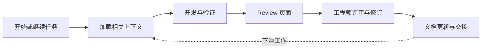

# Engineering Flow

> 让工程师读懂 AI 的改动，让 AI 接得上工程师的工作。

Engineering Flow 是一个面向 GitHub Copilot 的工程协作工具包，规划覆盖功能开发、代码理解与 Review、项目记忆、技术文档和长期维护。

英文介绍：

> An AI-assisted engineering toolkit for GitHub Copilot, connecting development, code review, project memory, and documentation.

## 当前状态

2026-11-08：M0–M4 已完成当前本机支持范围的实现与验收；M5 已加入可重复运行的 Python 构造试点和逐项证据表，覆盖失败、修复、Review、文档应用与独立进程续接。正式 Copilot、安装和升级回退沿用已验证结果；engineer-voice 固定规则由宿主 Agent 使用，程序保留原稿并核对保护内容。Hooks 默认关闭。首版候选范围、实际结果及真人语义评审/团队试点等未完成项见 [M5 验收](docs/14-m5-acceptance.md) 与 [STATUS.md](STATUS.md)。终端确认不构成身份认证。

产品名为 **Engineering Flow**。远程仓库为 [yanlong-l/engineering-flow](https://github.com/yanlong-l/engineering-flow)，当前目录已初始化 Git 并关联 `origin`；实际提交与远程分支以 Git 历史为准。

准备开始或继续开发时，查看根目录 [STATUS.md](STATUS.md)，其中记录当前阶段、下一会话目标和交接顺序。

## 核心体验

工程师从同一个入口开始或继续任务。工具读取相关项目记录，配合 Copilot 开发和验证，生成可回到实际代码及检查输出的 Review 页面，再保留必要的文档与交接信息，供下一次工作使用。



优先验证两项能力：

1. 工程师能更快理解并核对 AI 参与生成的改动。
2. 新会话和后续维护能正确使用已有信息，并识别已经过期的内容。

## 文档导航

| 文档 | 内容 |
| --- | --- |
| [背景与愿景](docs/01-background-and-vision.md) | 团队背景、提出产品的原因、目标用户与定位 |
| [产品需求](docs/02-product-requirements.md) | 核心场景、功能要求、首版范围和非目标 |
| [架构建议](docs/03-architecture.md) | Agent Plugin、主 Agent、Core、CLI/MCP、Hooks 和页面的职责 |
| [数据与状态](docs/04-data-and-state.md) | 任务、代码快照、检查记录、评审与状态变化 |
| [记忆与文档](docs/05-memory-and-documentation.md) | 保存、检索、过期、确认、归档和 engineer-voice 集成 |
| [Review 页面](docs/06-review-experience.md) | 页面结构、阅读路线、信息来源和交互 |
| [工作流与扩展](docs/07-workflows-and-extension.md) | 默认流程、配置层次、可插拔模块和降级方式 |
| [开发路线与验收](docs/08-roadmap-and-acceptance.md) | 分阶段交付、任务顺序和可执行验收场景 |
| [演示、指标与开发交接](docs/09-demo-metrics-and-handoff.md) | 分享演示、效果测量和下一次开发的起点 |
| [决定、待定事项与来源](docs/10-decisions-and-references.md) | 已确认事项、建议方案、未定选项和官方资料 |
| [本机开发环境验证](docs/11-environment-readiness.md) | 已运行的环境检查、可用 Copilot 会话组合和未验证事项 |
| [开源项目复用调研](docs/12-open-source-reuse-research.md) | 20 个仓库的复用建议、许可与维护依据、版本限制和各阶段验证安排 |
| [安装、诊断、升级与回退](docs/13-installation-and-upgrade.md) | wheel/插件安装、版本绑定、分页读取及回退合同 |
| [M5 构造试点与首版验收](docs/14-m5-acceptance.md) | 可复现流程、P0/AT 证据对应、失败记录和首版范围 |
| [当前开发状态与下一次交接](STATUS.md) | 当前阶段、下一会话目标及可拆分的交接单元 |

## 建议产品形态

以 **Agent Plugin + 单一主 Agent + 本地 Core + Review 页面** 为候选方案。内部使用少量 Skills；CLI 与 MCP 共用 Core；在目标客户端支持时用 Hooks 自动保存和刷新。

首个目标环境为 VS Code + GitHub Copilot，试点采用自行编写的 Python 示例项目。Core 采用 Python + SQLite；插件按 Agent Plugins 1.0 生成，绑定一个本机工作区。已验证环境和正式宿主调用的范围分别见环境记录与 STATUS，不外推到其他版本和电脑。

## 开始开发

后续开发先阅读 [AGENTS.md](AGENTS.md)、背景、需求、路线图及 [STATUS.md](STATUS.md)。M5 实现与验收范围见对应报告；交接以 STATUS 为准。构造示例见 `examples/batch-queue/`；检查结论必须有真实运行记录。

本阶段不需要外部模型服务、团队 SaaS 后台或向量数据库。模型推理优先沿用用户已有 Copilot 环境；本地记录和页面的生成由自己的程序实现。

## 当前 CLI 的安装与使用

本机实际验证 Python 3.14.3（含标准库 `sqlite3`）和 Git 2.49.0。当前包要求 Python >=3.14，其他版本和平台尚未验证。运行时无第三方 Python 依赖；构建后端固定为 `setuptools==80.9.0`，首次安装需要取得该构建依赖。

在本仓库根目录运行：

```sh
python3 -m venv .venv
.venv/bin/python -m pip install -e .
make check
make wheel
```

`make check` 执行独立进程测试、示例、M5 构造试点和 `pip check`；未安装可选 Copilot 依赖时，MCP 集成测试明确 skip，CLI/诊断测试仍运行。项目配置还要求 `copilot-runtime` 诊断，缺少 SDK 不能满足项目全部 required。`make copilot-check` 要求固定 SDK 已安装并执行真实 stdio 集成测试。`make wheel` 生成本地 wheel，不上传包。工程代码位于 `src/engineering_flow/core/`，CLI 和 MCP 适配层位于 `src/engineering_flow/adapters/`。

`make pilot-check` 可单独复现 M5，默认在 `.local/pilot-runs/随机ID/` 新建构造仓库，保留逐命令原始流、摘要、任务和 Review。也可运行 `.venv/bin/python tools/run_pilot.py --output .local/my-pilot` 指定新目录；不会覆盖已有目录。该脚本不调用模型或产生真人批准；机器经过时间不表示工程师节省工时。

```sh
.venv/bin/engineering-flow --workspace /path/to/git-repo task start \
  --goal '保存可续接的任务' \
  --accept '关闭进程后可按 ID 恢复' \
  --accept '进度不被解释为检查结果' \
  --issue '示例任务未接入生产环境'

# 将下面的 TASK_ID 替换为 start 返回的 task.id。
.venv/bin/engineering-flow --workspace /path/to/git-repo task checkpoint TASK_ID \
  --expected-revision 1 --progress '已保存目标与验收条件，下一步验证恢复'

# 每次命令均为新进程；resume 不改动用户代码。
.venv/bin/engineering-flow --workspace /path/to/git-repo task resume TASK_ID
```

`--workspace` 放在 `task` 前，默认当前目录；从仓库子目录运行时使用同一仓库根。成功时 stdout 返回 JSON；操作错误时 stderr 返回带 `error.code` 的 JSON 并退出 1，参数用法错误退出 2。`check run` 的失败、执行错误或快照不再适用时，stdout 仍返回运行 JSON，退出 3；仅 passed/current 退出 0。命令支持 `--help`。

任务保存在目标仓库根的 `.engineering-flow/state.sqlite3`，本仓库已忽略该目录；在其他仓库使用时也建议加入忽略规则。程序观察会排除该状态目录，避免把保存行为计为源码改动。数据仅保存在本机，不采集全部对话、调用模型或上传记录。

`checkpoint` 的 `--expected-revision` 取最近结果中的 `task.revision`，过期时拒绝覆盖；`--goal`、可重复的 `--accept`、`--issue` 和 `--file` 替换对应字段，省略则保留；`--clear-issues` / `--clear-files` 清空相应列表。`start` 也支持 `--file` 显式关联快照内的相对文件路径。关联只表达任务涉及该文件，不推断作者。每次保存追加修订，旧记录保留。

当前项目与工作区 ID 根据规范化的本地 Git 路径生成，不因相同 remote 自动共享。已保存的项目、工作区或分支不匹配时拒绝恢复；detached HEAD 切到其他提交也拒绝。移动仓库后的身份迁移不受支持。恢复不会回滚用户文件。

## 内容快照与启动基线

`start` 固定保存启动内容快照及已有改动清单，`checkpoint` 保存新的内容快照。任务、快照清单和内容 blob 在同一 SQLite 事务中提交；旧内容保留，可通过 `snapshot show` 读取。内容摘要覆盖工作区文件、暂存区、模式、HEAD/分支、diff 和输入范围，HEAD 不变的修改也会改变指纹。

`resume` 返回持久化的 `task` 与本次 `currentSnapshot`；`snapshotComparison.status` 表示与上次保存相比是 `current` / `stale` / `unknown`，`changesSinceStart` 与启动基线比较。这些状态只描述声明范围内的快照，不表示检查通过或 Review 已确认。已有改动与后续同文件修改保留不同内容依据，后续修改的作者始终未知。

默认输入包括所有 Git 跟踪文件（即使匹配忽略规则）和未被忽略的未追踪文件；状态目录和 Git 元数据排除。快照的 `scope.ignoredPaths` 显示 Git 忽略项，配置显式纳入的内容可以覆盖忽略规则。依赖被忽略的源码或数据时，在目标仓库根创建 `.engineering-flow.json`：

```json
{"schemaVersion": 1, "additionalInputs": ["ignored-source.py", "fixtures"]}
```

声明支持文件或目录，目录内的普通文件全部纳入；配置文件本身总是纳入。缺失声明、越界路径、符号链接、submodule、嵌套 Git 元数据、特殊文件和未解决合并会报错。当前限制为 2000 个文件、去重后内容 64 MiB，超限不保存不完整快照。连续两次采集不一致也会报错；这种方式不是原子或隔离快照，不能排除短暂修改后恢复，未声明的忽略文件和外部环境也不在保证范围内。

```sh
# SNAPSHOT_ID 取 task.startingWorkspace.snapshotId 或 task.savedWorkspace.snapshotId。
.venv/bin/engineering-flow --workspace /path/to/git-repo snapshot show SNAPSHOT_ID
.venv/bin/engineering-flow --workspace /path/to/git-repo snapshot show SNAPSHOT_ID --file src/app.py
.venv/bin/engineering-flow --workspace /path/to/git-repo snapshot show SNAPSHOT_ID --file src/app.py --layer index
.venv/bin/engineering-flow --workspace /path/to/git-repo snapshot show SNAPSHOT_ID --diff unstaged
```

内容以 JSON 返回，UTF-8 文本保留原文，其他二进制用 base64；不会将读取内容执行为脚本。历史快照只能在相同本地项目和工作区下读取，可以查看旧分支快照，但不会把它恢复成当前任务。

当前包为 `0.1.0.dev8`。数据库 schema 保持 v6，任务 schema 保持 v2，快照、记忆和文档建议 schema v1，检查兼容 v1/v2，Review/评审事件兼容 v1/v2/v3；v1–v5 数据库可直接读取，首次写入在事务内升级至 v6，原任务修订不改写。旧任务缺失的启动快照保持 `unknown`，不会补造。旧版 dev1–dev5 CLI 不能读取升级后的库。未知 schema、损坏清单或缺失/损坏 blob 会报错；锁超时、SQLite 容量不足和只读错误不会返回保存成功。目前没有自动修复、内容垃圾回收或任务历史查询命令。

## 真实检查与 Review 材料（M2）

在目标 Git 仓库根的 `.engineering-flow.json` 中配置检查；`additionalInputs` 可与 `checks` 同时使用：

```json
{
  "schemaVersion": 1,
  "checks": [
    {"id": "unit-tests", "required": true, "argv": ["{python}", "-B", "check_tests.py"], "cwd": ".", "timeoutSeconds": 60}
  ]
}
```

`id` 唯一；`required` 必须显式为布尔值；`argv` 是参数数组，按原样执行且不经过 shell。完整参数 `{python}` 替换成运行 CLI 的 Python。`cwd` 默认仓库根，仅允许根内普通目录；`timeoutSeconds` 默认 60，范围 0.1–3600 秒。未知字段报错。项目检查命令拥有调用者的本机权限，应先核对项目配置。没有个人覆盖接口；显式跳过保留原因且不满足必需项；修改项目必需项会改变快照，团队合并要求仍需适用的 CI/仓库规则落实。

```sh
.venv/bin/engineering-flow --workspace /path/to/repo check run TASK_ID unit-tests
.venv/bin/engineering-flow --workspace /path/to/repo check show RUN_ID
.venv/bin/engineering-flow --workspace /path/to/repo review build TASK_ID
.venv/bin/engineering-flow --workspace /path/to/repo review show REVIEW_ID
```

检查同步执行，先事务保存 `running` 及执行前快照，再保存真实 stdout/stderr、argv/cwd、Python/平台、开始/结束时间、退出码或执行错误和执行后快照。其他进程可用 `task resume` 获取运行 ID，再用 `check show` 查询；目前无后台作业调度。正常退出 0 为 `passed`，正退出码为 `failed`，启动、信号、超时、输出采集或结束快照失败为 `error`。每个输出流最多保存 4 MiB，超限终止进程组并标为 error，二进制以 base64 保留。命令及输出可能包含敏感信息，记录只在本机保存。

状态与适用性分开：前后快照和本次观察完全相同才是 `current`，有变化为 `stale`，缺失结束快照或仍在运行则是 `unknown`。`task resume` 返回 `verification`，同 ID 采用最近启动的检查；只有全部已配置必需检查的最新记录均为 passed/current，`requiredChecksPassed` 才为 true。未配置必需项也不产生全通过结论。检查命令退出 0 只证明该命令的成功约定，测试数量和断言须由命令本身保证。

执行模式为当前工作区，继承调用者环境，不保存环境变量。前后相同不能排除中途修改后恢复，外部依赖也不在内容指纹内。SIGINT/SIGTERM 尽力终止进程组并记录中断；SIGKILL、系统故障或结束写入失败可能留下 running/unknown，不补造结果，也不自动重跑。SIGKILL 后的子进程可能继续运行，当前无孤儿进程回收或后台恢复协议。执行器按本机 POSIX 行为实现，其他平台未验证。

Review 输出到 `.engineering-flow/reviews/REVIEW_ID/`：固定 `review.md`、结构化 `review.json`、`references.json`、生成时/启动时快照的 manifest、staged/unstaged diff、关联/变化文件的 worktree/index 原始内容、各运行的原始输出及 JSON。引用对应持久化快照，摘要可核对。Markdown 中的调用者文字转义，源码和日志只作为独立内容文件引用。材料保存在数据库后才导出，导出失败仍可 `review show` 读取。同时生成固定 `review.html`，内联展示转义后的代码/日志和快照行号链接，不加载外部资源或执行脚本。AI 解释、调用者意见与本地终端确认分区展示。

材料只描述生成时状态。`review show` 重新计算代码及任务修订适用性并返回 `currentVerification`、`currentReviewFeedback`；新检查或意见会令 `refreshNeeded=true`。旧材料不被改写。`review build` 创建新的材料包。原始运行和全部历史材料保留，目前没有分页、垃圾回收或导出失败后的文件包重建命令。

### 跳过、解释与评审

```sh
# 跳过仅保存未执行事实；即使原来通过，也以此次跳过为最新记录。
.venv/bin/engineering-flow --workspace /path/to/repo check skip TASK_ID unit-tests --reason '测试环境不可用'

# 意见绑定 REVIEW_ID 对应的快照及任务修订；省略 --file 表示整个任务。
.venv/bin/engineering-flow --workspace /path/to/repo review record REVIEW_ID \
  --decision request_changes --comment '需要补充重试冲突的检查' --file src/app.py

# 由操作者在本地交互终端运行；OPINION_ID 取 record.id。
.venv/bin/engineering-flow --workspace /path/to/repo review confirm OPINION_ID

# 结构化解释始终标为 AI 解释，绑定指定材料的快照。
.venv/bin/engineering-flow --workspace /path/to/repo review explain REVIEW_ID --input explanation.json
```

`review record` 仅保存调用者意见，decision 支持 comment / approve / request_changes；approve 意见本身不是人工确认。`review confirm` 通过独立终端适配器展示意见全文、范围与快照，要求键入当次随机 challenge；无管道、--yes、自报 actor/origin/confirmed 写入接口。取消不保存。程序从 OS 读取 uid/账号/控制终端；交互前后重新采集代码及任务修订，有变化就拒绝保存。确认记录只覆盖其范围，同范围后续确认替代旧记录，文件范围不推导整个任务获批；任何确认均不替代必需检查。

此入口采用本机终端信任边界，记录 `assurance=local_session_not_identity_verified`，不做身份认证。拥有同账号终端/PTY 自动化、Python 适配器或数据库写权限的程序仍能模拟本地操作；不能把这类记录当作抵御同账号 Agent 的强认证。默认拒绝调用者直接提交确认文字和非交互调用。测试使用自动化 PTY/模拟端口，不代表真实用户已经批准；若团队需要强来源，应后续接入可核验的 PR Review 或其他认证适配器。

解释 JSON 格式如下，验收条件从 1 编号；所有引用都属于 REVIEW_ID 的持久化快照：

```json
{
  "summary": "本次改动的行为解释",
  "behaviors": [
    {
      "title": "重试复用原任务",
      "description": "按请求标识查询已有批次，内容冲突时拒绝。",
      "acceptanceCriteria": [1],
      "references": [{"file": "src/app.py", "layer": "worktree", "startLine": 10, "endLine": 25}]
    }
  ]
}
```

`layer` 支持 worktree/index。越界路径和非法结构报错；文件缺失、行号越界或二进制行号在页面显示“引用失效”，不猜相近位置。解释过期时仍引用其原快照的代码；程序不会把解释升级为团队规则或人工确认。

页面用原生展开项查看运行、源码和 diff，支持桌面与窄屏。页面本身无写入或实时监测通道；请在 CLI 保存意见/确认后 build 新页。`humanConfirmation` 旧兼容字段保持空，实际意见/确认位于 `reviewFeedback.records` 与按范围计算的 `confirmedScopes`。只有当前快照及任务修订对应的确认参与该范围记录，历史记录保留。

可重复的通过、故意失败及修改后失效演示见 [构造示例](examples/batch-queue/README.md)。

## 候选记忆与续接上下文（M3-1）

记忆由显式操作保存，不采集全部对话、不调用模型或上传记录。正文统一视为调用者提交的候选；代码、检查或 AI 解释来源均不证明正文推断正确。输入示例：

```json
{
  "content": "构造候选：相同 request_id 与 Case 列表复用原批次，内容不同则拒绝。",
  "kind": "design_decision",
  "scope": {"kind": "paths", "paths": ["batch_queue.py"], "modules": ["queue"]},
  "keywords": ["request_id", "retry"],
  "sources": [{"kind": "code", "file": "batch_queue.py", "layer": "worktree", "startLine": 27, "endLine": 36}]
}
```

`kind` 支持 explanation / design_decision / convention / limitation。项目范围使用 `{"kind":"project","paths":[],"modules":[]}`；路径范围必须在当前快照内，可引用文件或目录。正文最多 16 KiB，来源 1–32 条。代码来源必须是快照中实际存在的 UTF-8 文本行（不接受含 NUL 的文本）；另支持 `{"kind":"check","id":"RUN_ID"}` 和 `{"kind":"review_event","id":"EVENT_ID"}`，必须属于相同任务及快照。运行中的检查不能作为不可变来源，终态失败/跳过保留实际状态；AI 解释保留 origin=ai，不升级成程序事实。来源不能使用任意外部 URL 或自报人名。

```sh
.venv/bin/engineering-flow --workspace /path/to/repo memory propose TASK_ID --input memory.json
.venv/bin/engineering-flow --workspace /path/to/repo memory show MEMORY_ID
.venv/bin/engineering-flow --workspace /path/to/repo memory context TASK_ID \
  --path src/queue --module queue --query retry --budget-bytes 8192
```

`task start/checkpoint/resume` 同时返回默认 `memoryContext`。检索依据任务、关联/显式路径、模块、关键词及项目范围；优先选择已确认且适用、没有显式冲突的背景，再按任务/路径/模块/关键词匹配排序，同分按稳定 ID 排序。`selected` 的每项包含正文、来源、状态和继续读取的命令参数；候选、过期或冲突项可以作为提示加载，只有 `eligibleAsCurrentBackground=true` 才是当前已确认背景。正文仍需工程判断。

预算精确限制 `selected` 用 `json.dumps(sort_keys=True, separators=(",", ":"), ensure_ascii=False)` 编码的 UTF-8 字节数，范围 2–1048576，默认 8192；不是模型 token 数或整个响应上限。放不下的记录整体排除，继续尝试后续较小项，不截断来源/条件。`excluded` 给出 budget / unrelated / rejected / superseded / archived / branch_mismatch 等原因及 `memory show` 参数；`complete=false` 表示有相关项因预算未加载。元数据、排除清单、关系和原任务正文不在此预算内。

确认和适用性分开：`confirmationStatus` 为 proposed / confirmed / rejected；适用性为 current / needs_revalidation / superseded / archived。未提交文件、配置、输入范围或所属任务修订变化后保守要求复核，原确认、正文与快照不改写。旧记忆需要更新时，读取当前来源再提出新候选；不能用新材料直接确认旧快照记忆。其他分支的正文不进入上下文，直接读取拒绝；工作区之间不共享本地记录。

可以在同一 Review 流程中评审一组记忆：

```sh
.venv/bin/engineering-flow --workspace /path/to/repo review build TASK_ID
.venv/bin/engineering-flow --workspace /path/to/repo review record REVIEW_ID \
  --decision approve --comment '核对正文条件及来源' --memory MEMORY_ID
# 由操作者在本地交互终端运行；此操作沿用前述本机信任边界。
.venv/bin/engineering-flow --workspace /path/to/repo review confirm OPINION_ID
```

`--memory` 可重复，最多 16 条，不能混用 `--file`；候选、材料和任务修订须完全对应。意见和确认都保留记忆完整内容及摘要，终端展示后才请求 challenge。approve 意见本身不确认；确认 approve / request_changes / comment 分别产生 confirmed / rejected / proposed。任务或文件范围的批准不隐式确认记忆，记忆范围也不代表任务获批；后续确认按每条记忆分别替代。

```sh
.venv/bin/engineering-flow --workspace /path/to/repo memory relate MEMORY_ID \
  --relation conflicts_with --other OTHER_ID --reason '两种决定的条件不一致'
.venv/bin/engineering-flow --workspace /path/to/repo memory relate NEW_ID \
  --relation supersedes --other OLD_ID --reason '保留旧来源，采用新候选'
.venv/bin/engineering-flow --workspace /path/to/repo memory relate MEMORY_ID \
  --relation archive --reason '不再参与默认上下文'
```

关系标记来自调用者，程序不做语义冲突识别。冲突项保留各自正文和来源，不能作为无冲突的当前背景。替代候选尚未确认时提示差异且保留旧项；新候选获得过明确批准后旧项为 superseded，后续拒绝或归档新项也不会自动复活旧规则。禁止跨分支/工作区关系、自关联和替代循环。归档不删除历史，目前无撤销归档、编辑正文、自动复核、团队共享或检索分页；大量历史的性能尚未专项验收。

## 文档建议、engineer-voice 与交接（M3-2）

`document propose` 只保存建议，不改工作区文档。输入包含目标、维护方式、原技术草稿、原因、实际来源和需要逐字保留的事实：

```json
{
  "target": "MAINTENANCE.md",
  "mode": "generated",
  "region": null,
  "draft": "相同请求复用原批次；请求内容不同时拒绝。此处为构造候选，仍需 Review。\n",
  "reason": "补充重试维护说明。",
  "sources": [{"kind":"code","file":"batch_queue.py","layer":"worktree","startLine":27,"endLine":36}],
  "protectedFacts": ["请求内容不同时拒绝", "构造候选", "仍需 Review"]
}
```

目标仅支持规范的仓库相对 `.md` 路径，正文上限 64 KiB；来源沿用记忆的代码/终态检查/评审事件合同，必须属于同任务快照。程序不自动判断哪些文档受影响，由调用者用目标和原因表达；来源存在不证明草稿正确。

| mode | 行为 |
| --- | --- |
| manual | 目标须在快照内；提交整篇建议，保留原文及 diff，供人工审阅 |
| generated | 允许新文件；已有文件须以 `<!-- engineering-flow:generated -->` 加换行开头。草稿不含该标记，程序生成标记 |
| mixed | 目标须存在，region 指定区域名；仅替换唯一 `<!-- engineering-flow:NAME:start -->` 与 `<!-- engineering-flow:NAME:end -->` 之间的内容，区域外逐字保留。缺失、倒序、重复或嵌套标记拒绝 |

被忽略且未进入快照的已有文档拒绝；将被忽略的新目标也拒绝，避免应用后无法观察内容。所有模式都只导出建议，当前没有自动应用命令。自行应用后完整输入快照变化，原检查、材料、解释和确认重新判定适用性。

```sh
engineering-flow --workspace /path/to/repo document propose TASK_ID --input document.json
engineering-flow --workspace /path/to/repo document show DOCUMENT_ID
engineering-flow --workspace /path/to/repo document export DOCUMENT_ID

# 显式读取固定 Skill、草稿和两个摘要，交给当前宿主 Agent 做独立改写。
engineering-flow --workspace /path/to/repo document voice DOCUMENT_ID
engineering-flow --workspace /path/to/repo document rewrite DOCUMENT_ID --input rewrite.json

# 建立材料后按建议 ID 选择范围，仍用现有终端确认入口。
engineering-flow --workspace /path/to/repo review build TASK_ID
engineering-flow --workspace /path/to/repo review record REVIEW_ID \
  --document DOCUMENT_ID --decision approve --comment '已核对文档与实现'
engineering-flow --workspace /path/to/repo review confirm OPINION_ID
engineering-flow --workspace /path/to/repo task handoff TASK_ID
```

export 在 `.engineering-flow/documents/DOCUMENT_ID/` 保存 proposal.json、before.md、after.md、change.patch，原文与完整改写候选也在 SQLite。重写输入严格为：

```json
{"proposalIntegrity":"取 voice 返回值","moduleDigest":"取 voice 返回值","rewritten":"宿主 Agent 返回的完整正文"}
```

内置 Skill 为 [engineer-voice v0.2.0 固定提交](https://github.com/yanlong-l/engineer-voice/tree/8dcf520fb3974e9711cf193ca78a9839a7fce5f0)，保留 MIT 许可、原始规则、词表、构造样例和七组语义回归材料。`voice` 校验模块文件和固定清单摘要，返回 `loaded` 仅表示文件已加载；`modelExecution=not_observed`，不证明模型已使用规则。CLI 不调用模型、不执行草稿命令、不访问正文链接、不自动上传。模块缺失或损坏时为 unavailable，保留原稿；不会声称已做改写。打包范围与第三方材料说明见 [THIRD_PARTY_NOTICES.md](THIRD_PARTY_NOTICES.md)。

rewrite 追加新候选并绑定原建议/模块摘要，原稿、旧确认均保留。程序比较常见 Markdown 保护区（围栏、表格行、引用、缩进代码、行内代码、URL、数值及已识别单位）、敏感词序和 protectedFacts 的逐字出现次数。保护内容变化时 voice.status=rejected，after 继续使用原技术草稿；否则为 protected_checks_passed，确认状态仍为 proposed。敏感词比较可能保守拒绝含义相同的改写；保留原稿是允许结果。此比较不能识别全部 Markdown、未知单位或所有主体/对象/因果变化，**不能把通过当作语义等价**；否定、条件、建议强度、范围与不确定性仍需 Review。

文档评审不与 `--file` / `--memory` 混用，最多 16 条；同组后续单条决定仅替代该条。任务/文件批准不自动批准文档，建议获批不证明已应用，也不替代必需检查。`confirmationStatus` 与 `applicability` 分开，旧确认保留，完整快照或任务修订变化后 needs_revalidation。

`task handoff` 与 `review build` 共用一次生成的快照和证据包，另导出 handoff.md / handoff.json：目标、进度、未决事项、实际检查、确认范围、文档建议及带状态的记忆上下文。它不宣告任务完成；未决事项来自调用者，生成后不会实时刷新。下一会话先 `task resume TASK_ID`。Review 页内联转义文档差异与来源，不执行 Markdown 中的脚本。

## 规划中的内容与实际结果

所有示例任务、页面、检查记录和指标均用于描述预期行为。没有实际执行结果时，不得声称已经通过检查、减少了多少评审时间或实现了自动记忆。

## Copilot 插件入口（M4）

完整步骤、最低支持范围、故障诊断与升级/回退合同见 [安装说明](docs/13-installation-and-upgrade.md)。先安装 wheel 的 `[copilot]` 可选依赖，再用同一运行环境为明确仓库生成新插件目录：

```sh
/path/to/runtime/bin/engineering-flow --workspace /path/to/repo doctor --require-mcp
/path/to/runtime/bin/engineering-flow --workspace /path/to/repo plugin build --output /path/to/new-plugin-directory
/path/to/runtime/bin/engineering-flow --workspace /path/to/repo plugin inspect /path/to/new-plugin-directory
```

在 VS Code 运行 Chat: Install Plugin from Source，选择目录；新建 Copilot 会话并选 Engineering Flow。一个 Agent 和两个内部 Skills 组织开始、继续、准备 Review、交接，状态共用 Core。生成/诊断成功不代表宿主已装载或已调用；真实结果见 STATUS。

MCP 通过 stdio 提供七组领域工具及只读 flow_read。默认大结果明确为摘要，按 presentation.responseId 与 JSON Pointer 分页取得完整原文，直到 nextOffset=null；每条默认展示/分页 JSON 不超过 6000 UTF-8 字节。缓存只属于当前服务进程，过期后按领域 ID show/resume，不重复写操作。缓存结果不是实时状态；CLI 继续提供原有完整 JSON。

生成包绑定本机工作区、产品版本、Python 路径/环境及文件清单，使用 -I 启动。它是固定路由，不认证请求来自哪个 IDE 窗口；切换仓库或升级后重新生成，不复用错误安装缓存。inspect 只读核对，不执行包内命令；问题以 JSON 返回并退出 1。文件摘要检测损坏，不提供身份认证。

MCP 没有任意命令、workspace 切换、自报检查结果、个人 required 覆盖或人工确认入口。失败检查保留真实运行 JSON 并标记 isError；取消不停止已开始检查，停止服务不保证后台运行。未收到回复时先查询状态。人工确认仍由操作者在独立终端执行既有 CLI，不由 Agent 代输 challenge。

产品不配置 Hooks，不采集全部对话、不监听网络或新增模型服务；显式路径完整可用。固定 engineer-voice 仍是 Markdown 规则，程序加载不代表模型已改写，保护比较不证明语义等价。M4 集成不等于 M5 首版验收或公开发布。
