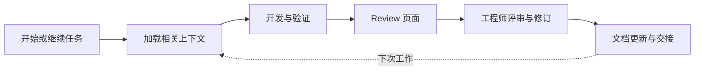

# Engineering Flow

> 让工程师读懂 AI 的改动，让 AI 接得上工程师的工作。

Engineering Flow 是一个面向 GitHub Copilot 的工程协作工具包，规划覆盖功能开发、代码理解与 Review、项目记忆、技术文档和长期维护。

英文介绍：

> An AI-assisted engineering toolkit for GitHub Copilot, connecting development, code review, project memory, and documentation.

## 当前状态

2026-11-07：已整理项目背景和产品规划，完成一次[本机开发环境与最小插件调用验证](docs/11-environment-readiness.md)，并完成[开源项目复用调研](docs/12-open-source-reuse-research.md)。尚未实现产品运行时、正式插件、Agent、页面或安装命令。本目录中的产品接口、配置和数据结构均为设计建议，不能视为已实现能力。

产品名为 **Engineering Flow**。用户已确认在 GitHub 创建 `engineering-flow` 仓库；完整远程地址和本地关联状态在首次开发时核对。

准备开始或继续开发时，查看根目录 [STATUS.md](STATUS.md)，其中记录当前阶段、下一会话目标和交接顺序。

## 核心体验

工程师从同一个入口开始或继续任务。工具读取相关项目记录，配合 Copilot 开发和验证，生成可回到实际代码及检查输出的 Review 页面，再保留必要的文档与交接信息，供下一次工作使用。

优先验证两项能力：

1. 工程师能更快理解并核对 AI 参与生成的改动。
2. 新会话和后续维护能正确使用已有信息，并识别已经过期的内容。

## 文档导航

| 文档 | 内容 |
| --- | --- |
| [背景与愿景](docs/01-background-and-vision.md) | 团队背景、提出产品的原因、目标用户与定位 |
| [产品需求](docs/02-product-requirements.md) | 核心场景、功能要求、首版范围和非目标 |
| [架构建议](docs/03-architecture.md) | Agent Plugin、主 Agent、Core、CLI/MCP、Hooks 和页面的职责 |
| [数据与状态](docs/04-data-and-state.md) | 任务、代码快照、检查记录、评审与状态变化 |
| [记忆与文档](docs/05-memory-and-documentation.md) | 保存、检索、过期、确认、归档和 engineer-voice 集成 |
| [Review 页面](docs/06-review-experience.md) | 页面结构、阅读路线、信息来源和交互 |
| [工作流与扩展](docs/07-workflows-and-extension.md) | 默认流程、配置层次、可插拔模块和降级方式 |
| [开发路线与验收](docs/08-roadmap-and-acceptance.md) | 分阶段交付、任务顺序和可执行验收场景 |
| [演示、指标与开发交接](docs/09-demo-metrics-and-handoff.md) | 分享演示、效果测量和下一次开发的起点 |
| [决定、待定事项与来源](docs/10-decisions-and-references.md) | 已确认事项、建议方案、未定选项和官方资料 |
| [本机开发环境验证](docs/11-environment-readiness.md) | 已运行的环境检查、可用 Copilot 会话组合和未验证事项 |
| [开源项目复用调研](docs/12-open-source-reuse-research.md) | 20 个仓库的复用建议、许可与维护依据、版本限制和各阶段验证安排 |
| [当前开发状态与下一次交接](STATUS.md) | 当前阶段、下一会话目标及可拆分的交接单元 |

## 建议产品形态

以 **Agent Plugin + 单一主 Agent + 本地 Core + Review 页面** 为候选方案。内部使用少量 Skills；CLI 与 MCP 共用 Core；在目标客户端支持时用 Hooks 自动保存和刷新。

首个目标环境已确定为 VS Code + GitHub Copilot，试点采用自行编写的 Python 示例项目。本机已验证 VS Code 中的 Copilot SDK 会话可加载 Agent Plugins 1.0 探针并调用工具；Core 语言及正式插件的分发方式仍需完成选型和验收。

## 开始开发

后续开发先阅读 [AGENTS.md](AGENTS.md)、背景、需求、路线图及 [STATUS.md](STATUS.md)。本机最小兼容性已经验证；先完成剩余选型与工程准备，再实现任务创建、保存和新进程恢复。随后扩展到真实检查、Review 和续接的完整流程。新会话的可复制提示见[开发交接](docs/09-demo-metrics-and-handoff.md)。

本阶段不需要外部模型服务、团队 SaaS 后台或向量数据库。模型推理优先沿用用户已有 Copilot 环境；本地记录和页面的生成由自己的程序实现。

## 规划中的内容与实际结果

所有示例任务、页面、检查记录和指标均用于描述预期行为。没有实际执行结果时，不得声称已经通过检查、减少了多少评审时间或实现了自动记忆。
