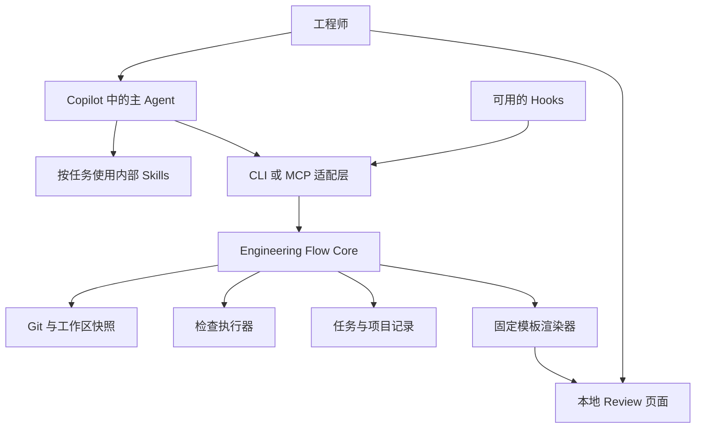

# 架构建议

状态：候选方案。客户端支持和企业策略需要在 M0 验证后确定。

## 总体结构



Agent Plugin 作为分发方式组织 Agent、Skills、Hooks 与 MCP 配置，不等于图中所有组件已经由 Copilot 原生实现。

## 各组件职责

| 组件 | 职责 | 不应承担的职责 |
| --- | --- | --- |
| 主 Agent | 理解任务、选择流程、读代码、实现、解释和提出建议 | 伪造执行记录、直接决定检查通过 |
| Core | 任务状态、快照、记录存储、检索、有效性判断 | 把所有历史内容塞给模型 |
| CLI | 显式操作入口、调试及无 Hooks 环境的降级 | 另写一套任务规则 |
| MCP 适配层 | 将 Core 操作以结构化工具提供给 Copilot | 对每项操作另存一套状态 |
| 检查执行器 | 执行已配置的命令，采集真实结果 | 仅接收模型的“通过”文字 |
| Hooks | 调用保存、刷新、记录等程序 | 充当完整权限系统或唯一执行路径 |
| Skills | 定向流程、领域说明、技术表达改写 | 代替版本化状态存储 |
| 页面渲染器 | 从结构化材料生成稳定页面 | 每次让模型生成任意可执行 HTML |

## 技术栈建议

建议优先评估 TypeScript + Node.js，理由是方便共享 CLI、MCP 和页面的数据类型，也便于后续接入 VS Code。用户没有确认该选型；M0 后根据环境、维护成本和现有经验决定。

存储首版可采用可读的 JSON / Markdown 文件，配合 schema 校验、原子替换和任务级写入锁。开源复用调研后，建议 M0 同时比较 SQLite：若文件方案需要自行实现复杂的跨记录事务和锁管理，SQLite 可能更合适，可读材料通过导出保留。两者仍未采用；原子替换不等于跨进程互斥。候选组件和当前 Node 版本限制见[开源复用调研](12-open-source-reuse-research.md)。页面先用本地 HTML；不依赖远程 UI 服务。

首版检索使用任务关联、模块、路径与关键词，不以向量数据库为前提。模型服务沿用 Copilot，Core 首版无需自行调用 LLM API。

## 逻辑接口建议

下面是产品 Core 的候选操作，不是已实现命令，也不是 Copilot 官方工具名：

| 操作 | 输入重点 | 返回重点 |
| --- | --- | --- |
| `project.inspect` | 当前工作区 | 仓库身份、可用能力、配置问题 |
| `task.start` | 需求、验收条件、范围 | 任务 ID、启动快照和已有改动 |
| `task.resume` | 任务 ID、当前工作区 | 匹配状态、有效上下文和差异 |
| `task.checkpoint` | 任务 ID、进度 | 保存版本、当前快照 |
| `context.select` | 任务、模块、输入预算 | 相关记录、来源、遗漏说明 |
| `check.run` | 任务 ID、已配置检查 ID | 检查运行 ID 和执行状态 |
| `check.get` | 运行 ID | 输出引用、结果和适用性 |
| `review.build` | 任务 ID、快照 | 页面位置、材料缺项 |
| `review.record` | 评审意见、范围、快照 | 评审记录 |
| `memory.propose` | 内容、来源、适用范围 | 待确认记录 |
| `task.handoff` | 下一步、未决事项、文档变化 | 可供下次续接的交接记录 |

检查耗时较长时返回运行 ID，再查询结果；不能依赖一次工具调用始终保持连接。

涉及人工确认的接口应验证调用来源。模型调用写入“confirmed”不能充当人工确认；首版可通过显式 CLI 操作或已有 PR Review 流程记录确认。

## 可安装包与开发目录

建议将应用源代码与生成的插件包区分。以下仅表示职责组织，正式目录在选型后确定：

```text
core/                 # 状态、快照、检查、检索、渲染
adapters/cli/         # 显式操作入口
adapters/mcp/         # MCP 工具适配
ui/                   # 固定页面模板与资源
plugin-source/        # 主 Agent、Skills、Hooks 的源文件
schemas/              # 版本化数据约束
tests/                # 可信度与恢复行为的验证
examples/             # 明确标注的构造案例
```

可安装插件的 manifest、目录和 Hooks 字段按照目标客户端的官方格式生成并验证，不把本项目的开发目录当成标准插件目录。参考 [Agent Plugin 编写说明](https://code.visualstudio.com/docs/agents/reference/agent-plugin-reference)。

## 集成边界

首个目标建议为本地 VS Code + GitHub Copilot。插件中的可移植部分和客户端专属部分分别管理；不要推断一个客户端的安装成功等于其他客户端也支持。

Hooks 可选启用，显式操作始终可用。需要核验的包括触发事件、载荷格式、超时、失败行为、工作目录以及公司策略。以实际事件测试结果为准。[Hooks 官方说明](https://code.visualstudio.com/docs/agent-customization/hooks)

本地页面先展示材料；交互写入可以由 CLI 完成。需要页面直接保存评审意见、实时失效提醒和精确 IDE 跳转时，再选择本地服务或 VS Code Webview。

## 并发与恢复

记录带版本号，写入通过临时文件和原子替换完成；同任务写入使用锁或比较版本，拒绝静默覆盖。进程中断后保留最后一个有效版本，未完成的检查不能变为通过。

项目、worktree、任务和快照分别标识。共享 Git remote 不足以证明两个工作区相同。多实例共享及团队服务以后再扩展，不在首版假设全局写入安全。
