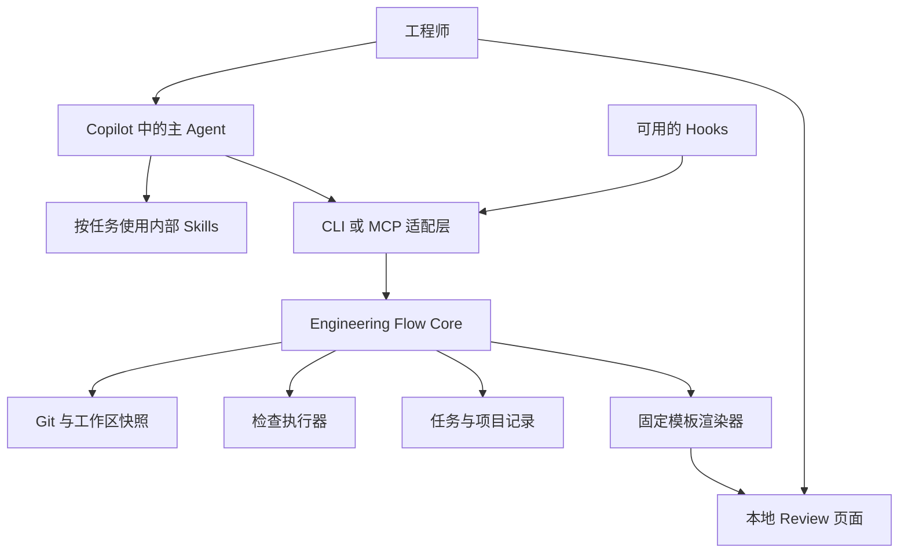

# 架构建议

状态：M0–M4 已实现 Python Core、CLI、内容快照、SQLite、真实检查、Review、候选记忆、文档与交接，以及共用 Core 的 MCP、正式插件、诊断与安装/升级。固定 Markdown 表达规则由宿主 Agent 显式加载。验收范围见 STATUS，终端来源不构成身份认证。历史探针验证见环境记录。

## 总体结构



Agent Plugin 作为分发方式组织 Agent、Skills、Hooks 与 MCP 配置，不等于图中所有组件已经由 Copilot 原生实现。

## 各组件职责

| 组件 | 职责 | 不应承担的职责 |
| --- | --- | --- |
| 主 Agent | 理解任务、选择流程、读代码、实现、解释和提出建议 | 伪造执行记录、直接决定检查通过 |
| Core | 任务状态、快照、记录存储、检索、有效性判断 | 把所有历史内容塞给模型 |
| CLI | 显式操作入口、调试及无 Hooks 环境的降级 | 另写一套任务规则 |
| MCP 适配层 | 将 Core 操作以结构化工具提供给 Copilot | 对每项操作另存一套状态 |
| 检查执行器 | 执行已配置的命令，采集真实结果 | 仅接收模型的“通过”文字 |
| Hooks | 调用保存、刷新、记录等程序 | 充当完整权限系统或唯一执行路径 |
| Skills | 定向流程、领域说明、技术表达改写 | 代替版本化状态存储 |
| 页面渲染器 | 从结构化材料生成稳定页面 | 每次让模型生成任意可执行 HTML |

## 技术栈建议

M0 比较后采用 Python >=3.14，当前验证版本为 3.14.3；CLI 用标准库 `argparse`，运行时数据校验留在 Core。TypeScript + Node.js 的跨入口类型共享有优势，但本轮采用 Python 可沿用已验证环境与后续 Python MCP 路径，并避免原生 Node 存储依赖的安装成本。页面可在需要时独立打包；目前没有引入前端运行时。具体取舍见[决定记录](10-decisions-and-references.md)。

存储已采用标准库 `sqlite3`，任务修订与 schema 版本放在本机数据库中，以事务追加修订，并比较调用者提供的预期修订号。相较 JSON 文件，减少了自行实现锁、刷盘和历史记录一致性的代码；当前 CLI 输出可读 JSON，M2-1 Review 可导出固定 JSON/Markdown 证据包。网络共享目录与完整故障恢复未验收。页面已使用固定本地 HTML，不依赖远程 UI 服务。

首版检索使用任务关联、模块、路径与关键词，不以向量数据库为前提。模型服务沿用 Copilot，Core 首版无需自行调用 LLM API。

## 逻辑接口建议

下面是产品 Core 的候选操作，不是已实现命令，也不是 Copilot 官方工具名：

| 操作 | 输入重点 | 返回重点 |
| --- | --- | --- |
| `project.inspect` | 当前工作区 | 仓库身份、可用能力、配置问题 |
| `task.start` | 需求、验收条件、范围 | 任务 ID、启动快照和已有改动 |
| `task.resume` | 任务 ID、当前工作区 | 匹配状态、有效上下文和差异 |
| `task.checkpoint` | 任务 ID、进度 | 保存版本、当前快照 |
| `context.select` | 任务、模块、输入预算 | 相关记录、来源、遗漏说明 |
| `check.run` | 任务 ID、已配置检查 ID | 检查运行 ID 和执行状态 |
| `check.get` | 运行 ID | 输出引用、结果和适用性 |
| `review.build` | 任务 ID、快照 | 页面位置、材料缺项 |
| `review.record` | 评审意见、范围、快照 | 评审记录 |
| `memory.propose` | 内容、来源、适用范围 | 待确认记录 |
| `task.handoff` | 下一步、未决事项、文档变化 | 可供下次续接的交接记录 |

当前 M2-1 的 CLI 同步执行受限时长的检查，运行前已保存 running；其他进程可通过 task resume 取得运行 ID 后 check show 查询。进程强杀不补造完成。后台任务与异步工具协议仍待需要时实现。

涉及人工确认的接口应验证调用来源。模型调用写入“confirmed”不能充当人工确认；首版可通过显式 CLI 操作或已有 PR Review 流程记录确认。

## 可安装包与开发目录

建议将应用源代码与生成的插件包区分。以下仅表示职责组织，正式目录在选型后确定：

```text
core/                 # 状态、快照、检查、检索、渲染
adapters/cli/         # 显式操作入口
adapters/mcp/         # MCP 工具适配
ui/                   # 固定页面模板与资源
plugin-source/        # 主 Agent、Skills、Hooks 的源文件
schemas/              # 版本化数据约束
tests/                # 可信度与恢复行为的验证
examples/             # 明确标注的构造案例
```

可安装插件的 manifest、目录和 Hooks 字段按照目标客户端的官方格式生成并验证，不把本项目的开发目录当成标准插件目录。参考 [Agent Plugin 编写说明](https://code.visualstudio.com/docs/agents/reference/agent-plugin-reference)。

## 集成边界

首个目标建议为本地 VS Code + GitHub Copilot。插件中的可移植部分和客户端专属部分分别管理；不要推断一个客户端的安装成功等于其他客户端也支持。

Hooks 可选启用，显式操作始终可用。需要核验的包括触发事件、载荷格式、超时、失败行为、工作目录以及公司策略。以实际事件测试结果为准。[Hooks 官方说明](https://code.visualstudio.com/docs/agent-customization/hooks)

本地页面先展示材料；交互写入可以由 CLI 完成。需要页面直接保存评审意见、实时失效提醒和精确 IDE 跳转时，再选择本地服务或 VS Code Webview。

## 并发与恢复

任务修订、内容快照清单和去重 blob 在同一 SQLite 事务内追加；同任务写入比较预期修订，拒绝静默覆盖。数据库 v1–v5 在首次写入时事务升级至 v6，旧 document 保留，缺失的旧启动快照不补造。恢复会核验清单和 blob 摘要。

已实际验证独立进程争用同修订、写入中途强杀、锁超时、SQLite 页数上限触发容量不足、只读连接和部分迁移失败的回滚。系统真实磁盘耗尽、断电、网络文件系统等未验证；不从 SQLite 机制推导这些场景通过。快照使用连续两次内容采集比较，范围和忽略项显式记录，不承诺原子采集或隔离执行。M2-1 执行器先保存 running 和输入快照，再采集真实输出并事务提交终态及结束快照；结果适用性另行计算。Review 使用固定 HTML/Markdown 模板与独立内容文件；解释、意见和终端确认分别记录，确认经独立交互适配器写入。页面不执行动态输入或外部脚本，不含持久化按钮。

项目、worktree、任务和快照分别标识。共享 Git remote 不足以证明两个工作区相同。多实例共享及团队服务以后再扩展，不在首版假设全局写入安全。

M3-1 的记忆正文、关系和来源规则集中在 Core，CLI 仅解析输入；候选与快照同事务保存，提交时再核对任务修订。任务续接调用同一个上下文选择函数，避免适配层复制检索与失效逻辑。记忆范围评审内嵌原始候选，不扩大为任务批准。

## M4-1 已实现的插件边界

`adapters/mcp.py` 复用官方 Python MCP SDK 2.3.0 的 stdio 协议；`adapters/operations.py` 只定义工具 schema 和 Core 参数映射。七组工具覆盖任务、检查、Review、记忆、文档、快照与诊断，不新增存储表或另一套状态机。CLI 无需安装此可选 SDK。

`adapters/copilot.py` 从随 wheel 的 `resources/copilot/` 生成 Agent Plugins 1.0 目录，提供一个 Agent 和两个按需加载的内部 Skills。输出绑定规范化的本地 projectId/workspaceId 和 Python 路径；MCP 启动及每次调用核对项目与工作区身份，既有任务仍由 Core 核对分支。绑定是路由约束，不能认证请求来自哪个 IDE 窗口；Agent 必须先核对当前宿主路径，不支持同一安装自动切换仓库。

MCP 参数不接受工作区切换、任意命令、自报检查结果或人工确认；确认继续由独立终端适配器处理。一个服务串行执行，工作线程内复用同步 Core；请求取消不丢弃已经开始的检查，其配置超时仍有效。进程停止可能留下 running/unknown，不承诺后台运行。没有网络监听、外部模型服务、全对话保存或默认 OTel middleware。

只读 `doctor` 使用相同快照采集与配置解析，显示可用性和降级，不运行检查、不创建数据库。插件加载/调用/改写属于实际宿主证据，不能由诊断自报通过。产品包默认无 Hooks；显式路径始终可用，事件探针不自动成为产品自动保存能力。


## M4-2 安装与展示适配

生成绑定 schema v2 包含产品版本、Python 环境、工作区和文件摘要。plugin inspect 只读核对 manifest/MCP 启动参数与完整文件清单，拒绝未声明组件；不执行 mcp.json 的命令。启动使用 -I，旧绑定、版本/环境变化或运行中安装版本变化均明确拒绝，不承诺热升级。Core 的数据库/schema 仍为 v6，dev7/dev8 的实际升级回退单独验证，不能外推到未来迁移。

adapters/responses.py 只承担展示：默认大结果通过摘要与进程内只读 flow_read 提供，七组领域工具之外增加一个读取工具。原始 Core 结果和领域 ID 不改写；字符串按原文分页，Unicode 字符 offset、全文摘要和 nextOffset 支持完整读取。缓存明确是捕获时结果，不能重新解释为当前适用；状态变化仍调用 Core 的 resume/show 判断。缓存不落盘、不收集全部对话，过期后重新读取领域记录，不重试写操作。预算和限制见安装说明。

安装、诊断、重新生成/注册、升级与回退的当前合同见 [安装说明](13-installation-and-upgrade.md)；实际程序与宿主结果见 STATUS。显式路径不依赖 Hooks。个人展示使用每次调用的 summary/full 选项，不能改变项目 required；持久个人配置和 quick/extended 预设尚未实现。
